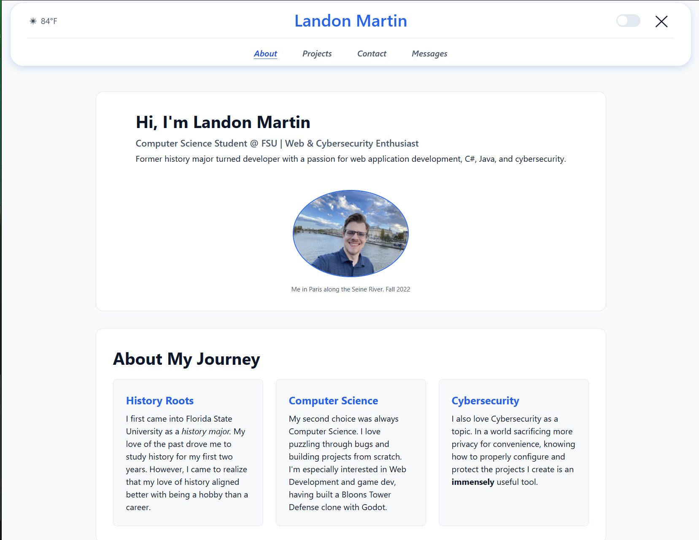

# Landon Martin Portfolio

## Description

A personal portfolio and profile site built for my CGS3066 Web Programming and Design class. It features CSS flexbox and grid, a light/dark mode theme toggle that persists using `localStorage`, and live Tallahassee weather data fetched from the National Weather Service API. The frontend is served by a custom Node.js/Express backend that also handles a functional contact form, saving submitted messages to a persistent file storage.

## How to Run

To run this project locally:

1. Unzip the project folder and open your terminal inside the root directory.
2. Run `npm install` to install dependencies
3. Run `node server.js` to start the server.
4. Go to `http://localhost:3000`.

## External Assets & Sources

- **Images:**
  - `me.jpg`: Personal photo.
  - `stormlight_archive_symbol.jpg`: The symbol of the Stormlight Archive Book Series (Property of Brandon Sanderson).
  - Project screenshots (`no-more-marble-racing-*.png`, `fakeasana-*.png`, `pythonbank-*.png`) are screenshots of my own personal projects.
- **Live Data API:** National Weather Service API used to fetch the current temperature for Tallahassee.

## Screenshot

